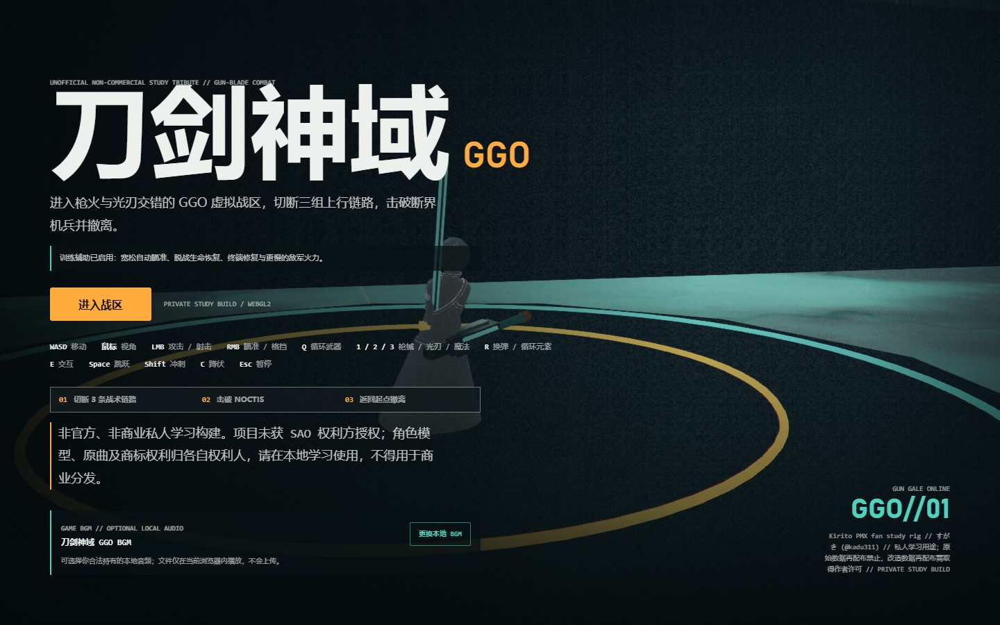
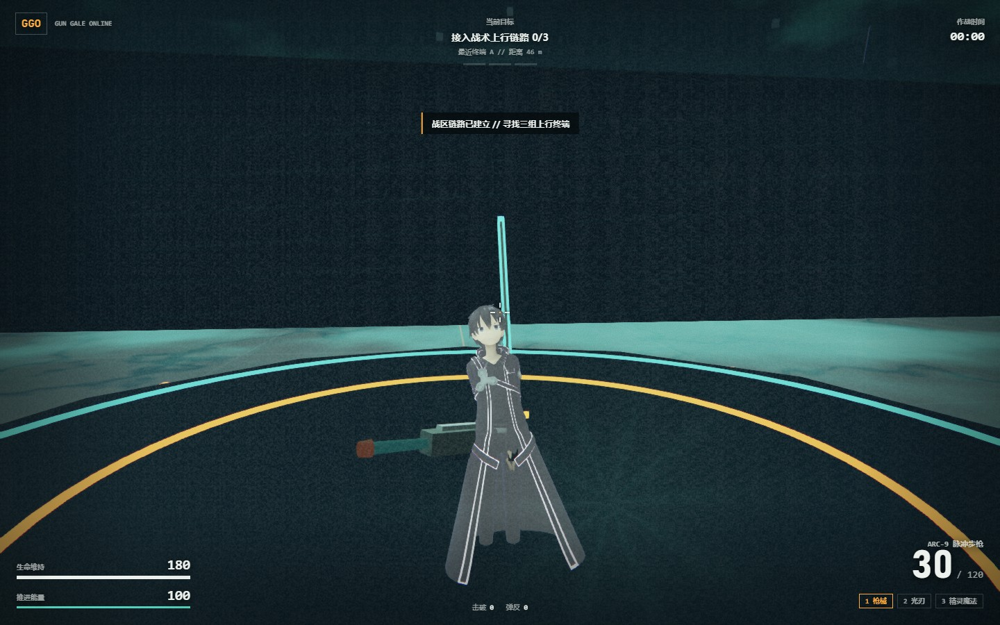
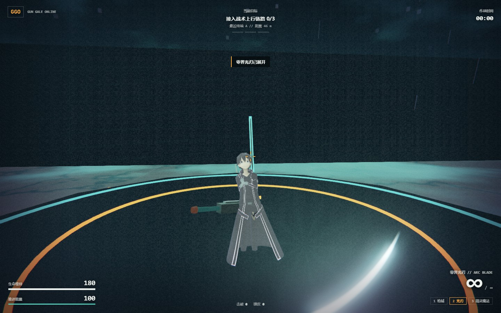

# 刀剑神域 GGO

一个使用 Three.js 和 WebGL2 编写的非官方、非商业 3D FPS 学习项目。它不是一张预设动画或孤立的视觉 Demo，而是把实时游戏循环、玩家控制、敌人状态、目标交互、精灵魔法、程序化材质、后处理和音频反馈组合在一起的可运行原型。

当前公开版包含完整的 GGO 港湾、ALO 风之浮岛、世界树根三区战役。玩家需要依次完成各区域目标、击破区域守门者并撤离；只有完成世界树核心的最终撤离，才会触发全域通关。

公开版只包含原创代码、程序化场景和合成音效，不包含原作角色模型、动画、纹理、原创 BGM 或其他第三方美术资源。项目名称中使用 `刀剑神域`、`GGO` 和 `ALO` 仅用于说明学习主题；相关商标和世界观权利归各自权利人所有。

## 效果预览

以下截图来自本地私用学习构建，用于展示导入的桐人模型、枪械、光刃和实时 HUD。仓库不包含角色模型、纹理或 BGM 原文件；复现私用版所需的素材请按本文末尾的部署说明在本地准备。



| 枪械模式 | 光刃模式 |
| --- | --- |
|  |  |

## 立即运行

需要 Node.js 18 或更高版本。

```powershell
npm install
npm run build
npm run serve
```

然后打开 `http://127.0.0.1:4173/docs/index.html`。

公开版默认不加载音乐。进入页面后可以在标题页或暂停菜单选择你合法持有的本地音频，音频只在当前浏览器中播放，不会上传到服务器。

## 操作

| 输入 | 功能 |
| --- | --- |
| `WASD` | 移动 |
| 鼠标 | 视角 |
| 鼠标左键 | 射击 / 光刃攻击 / 魔法蓄力 |
| 鼠标右键 | 瞄准 / 格挡 |
| `1` / `2` / `3` | 枪械 / 光刃 / 精灵魔法 |
| `Q` | 循环武器 |
| `R` | 换弹；魔法模式下循环火、冰、风、雷元素 |
| `E` | 接入终端或激活当前区域目标 |
| `Space` | 跳跃 |
| `Shift` | 冲刺 |
| `C` | 蹲伏 |
| `Esc` | 暂停 |

触屏设备会显示虚拟摇杆和攻击、跳跃、格挡、魔法、元素、蹲伏按钮。标准 Gamepad 也会被轮询处理。

## 三区战役

每个区域都按“区域目标 → 守门者 Boss → 撤离点”推进。撤离当前区域后会进入下一战区，并补充满弹匣、满备弹和满 MP；生命值仍按训练辅助规则恢复。

| 区域 | 区域目标 | Boss | 撤离点 |
| --- | --- | --- | --- |
| `01 // GGO 港湾数据区` | 按住 `E` 接入 A、B、C 三组战术上行链路 | `NOCTIS // 断界机兵`，720 生命 | 返回 `(0, 47)` |
| `02 // ALO 风之浮岛` | 激活 WIND-A、WIND-B、WIND-C 三枚风元素符文；可借助上升气流改变高度 | `SYLPH GUARDIAN // 风之守卫`，780 生命 | 返回 `(0, 40)` |
| `03 // 断界核心 / 世界树根` | 激活 SEAL-A、SEAL-B 两枚核心封印 | `YGGDRASIL CORE // 世界树核心`，980 生命 | 最终撤离点 `(0, 36)` |

进入 Boss 阶段后，目标指示会切换到当前守门者。Boss 生命降至约 48% 时进入第二阶段，提高攻击频率并加入近界斩击或弹幕组合。只有击破当前区域 Boss 后，撤离信标才会出现。

### 世界树安全垫

世界树核心有三个带金色光环的安全垫：

| 安全垫 | 坐标 | 半径 |
| --- | --- | --- |
| `safe-west` | `(-25, 19)` | `4.2` |
| `safe-east` | `(25, -20)` | `4.4` |
| `safe-entry` | `(16, 25)` | `4.0` |

安全垫只免疫世界树核心定期释放的冲击脉冲，不免疫普通敌人或最终 Boss 的投射物。站在圈内仍需要观察弹道、使用掩体并主动还击。

### 训练辅助

默认启用训练辅助，目标是让第一次接触本项目的玩家也能完整体验任务流程：

- 玩家拥有 `180` 点生命，受到攻击后有短暂无敌时间，脱战 `3` 秒后每秒恢复 `12` 点生命。
- 每接入一个终端恢复最多 `50` 点生命，因此不必等生命回满再推进目标。
- 进入第二、第三战区时自动补满弹匣、备弹和 MP，避免前一区耗尽资源后无法应对最终守门者。
- 枪械带有角度受限的软瞄准；准星接近敌人时会更容错，但仍会被墙体阻挡。
- 光刃三连击具备更长攻击距离和更高伤害，适合在近距离清理追击单位。
- 敌军伤害、射速和弹道速度均经过降低；三个 Boss 的生命值分别为 `720`、`780` 和 `980`。

稳妥的通关节奏是：沿掩体外侧接近目标，先清理最近的追击单位，完成目标后回血；Boss 阶段保持中距离并使用枪械或魔法输出，生命较低时优先退到掩体后等待恢复，不要在原地换弹。世界树阶段应利用安全垫规避核心脉冲，但仍要横向移动躲开 Boss 弹幕。

GGO 港湾目标参考坐标：

| 目标 | 坐标 |
| --- | --- |
| 终端 A | `(-33, 16)` |
| 终端 B | `(22, 2)` |
| 终端 C | `(-12, -21)` |

## 技术结构

- `src/main.js`：游戏循环、玩家控制、敌人和 Boss、目标交互、武器、魔法、输入、音频反馈与渲染管线。
- `src/core.mjs`：纯逻辑层面的任务、武器和弹反状态。
- `src/campaign-state.mjs`：区域顺序、目标阶段、Boss 阶段、撤离和全域胜利状态机。
- `src/zone-config.mjs`：三个区域的出生点、边界、目标、Boss、敌人和场景机制配置。
- `src/magic-state.mjs`：火、冰、风、雷四元素的蓄力、MP、冷却和投射物状态。
- `src/combat-feedback.mjs`：后坐力、镜头反馈、准星扩散和命中反馈。
- `src/movement-feedback.mjs`：步态相位、脚步事件、身体起伏和落地反馈。
- `src/bgm-controller.mjs`：本地 BGM 的加载、播放、暂停和错误状态。
- `src/model-loader.js`：可选的本地角色模型适配层；公开构建不会调用它。
- `src/vendor/mmd`：来自 Three.js 示例的 MMD 适配代码，遵循 MIT 许可证。

渲染部分包含程序化金属、湿润地面、裂缝、积水、雨滴和天空材质；后处理包含环境光遮蔽、Bloom、FXAA、自动曝光、ACES/软胶片色调映射、色彩分级、胶片颗粒和暗角。音效通过 Web Audio API 合成，不依赖公开 BGM 文件。

区域内容集中在 `src/zone-config.mjs`，战役阶段转换位于 `src/campaign-state.mjs`。新增区域时先扩展区域定义和阶段校验测试，再在 `src/main.js` 中绑定对应场景构建器与机制。

## 配置三区战役

每个区域至少需要以下字段：

- `id`、`name`、`shortName`、连续的 `order`
- `bounds`、`spawn`
- `objectiveLabel`、`objectiveCount`、`objectivePoints`
- `boss`、`extraction`
- `enemySpawns`、`environment`、`mechanics`

`objectivePoints.length` 必须与 `objectiveCount` 一致，出生点、目标、敌人和撤离点都必须位于 `bounds` 内。`environment` 当前支持 `harbor`、`floating-island` 和 `world-tree-root`。

## 构建版本

```powershell
npm test
npm run build
node tests/browser-zones.mjs
node tests/browser-public.mjs
node tests/browser-playthrough.mjs
```

`browser-playthrough.mjs` 会通过真实的键盘和鼠标流程走完三个区域，不使用传送、注入伤害或强制完成目标。公开构建输出到 `docs/index.html`，适合直接作为 GitHub Pages 的静态入口。

## 私用版：在另一台电脑部署

私用版用于在本机加载你有权使用的角色模型和音乐。它不是公开资源包，也不应把生成物或第三方素材上传到 GitHub、GitHub Releases、网盘、聊天群或 GitHub Pages。

尤其需要注意：

- 当前示例桐人 PMX 的作者许可写明“原始数据再配布禁止”。应回到[作者发布页](https://bowlroll.net/file/96677)取得模型，不要从本仓库或其他人的二次打包中下载。
- 原作 BGM 不在本项目中授权。请自行准备你有权在本地学习使用的 MP3，不要提交或分享。
- GitHub 的 Private 仓库也不等于取得了素材再分发许可。私有版应只保留在你自己的电脑上。
- `刀剑神域GGO.html` 内嵌 BGM，但仍会从 `models/` 通过本地 HTTP 服务器加载 PMX 和纹理。它不是“只复制一个 HTML 就能在另一台电脑显示角色”的离线单文件。

### 1. 准备代码和 Node.js

新电脑先安装 Git、Node.js 18 或更高版本，然后执行：

```powershell
git clone https://github.com/cmdch2017/sword-art-online-ggo.git
cd sword-art-online-ggo
npm ci
```

`npm ci` 会严格按照 `package-lock.json` 安装依赖；没有锁定安装需求时也可以使用 `npm install`。

### 2. 建立私用资源目录

在仓库根目录执行：

```powershell
New-Item -ItemType Directory -Force assets, models\player\kirito-sugaki | Out-Null
```

最终目录至少应包含：

```text
sword-art-online-ggo/
├─ assets/
│  └─ ggo-bgm.mp3
├─ models/
│  ├─ manifest.json
│  └─ player/
│     └─ kirito-sugaki/
│        ├─ model.pmx
│        └─ Textures/
│           └─ 原始纹理文件...
├─ src/
├─ build.mjs
└─ package.json
```

`assets/`、`models/` 和私用版 HTML 已在 `.gitignore` 中排除。不要把忽略规则删掉。

### 3. 放入角色模型

从[原作者发布页](https://bowlroll.net/file/96677)取得 PMX 模型，并按压缩包原有结构解压。必须保留 PMX 文件内部引用的相对路径和文件名，尤其是 `Textures/` 的大小写与日文文件名。Windows 通常不区分大小写，但部署到 Linux 服务器时会区分。

目标位置：

```text
models/player/kirito-sugaki/model.pmx
models/player/kirito-sugaki/Textures/...
```

如果模型包解压后多套了一层目录，需要把 `model.pmx` 和它对应的 `Textures/` 放到 `models/player/kirito-sugaki/` 下。可以用下面的命令检查：

```powershell
Get-ChildItem -Recurse models\player\kirito-sugaki
```

如果确实要把日文纹理改成 ASCII 文件名，需要在清单的 `mmdTextureMap` 中逐项写明“PMX 内的原路径”到“仓库内新路径”的映射；没有改名时不需要这个字段。

### 4. 创建私用模型清单

在 `models/manifest.json` 新建清单。下面是适配当前手部武器挂点的最小模板；把文件保存为 UTF-8：

```json
{
  "version": 1,
  "defaultCharacter": "player-kirito-sugaki",
  "models": [
    {
      "id": "player-kirito-sugaki",
      "kind": "character",
      "slot": "player",
      "enabled": true,
      "source": "models/player/kirito-sugaki/model.pmx",
      "label": "Kirito local study model",
      "author": "すがき (@kadu311)",
      "license": "Private study only; original model must not be redistributed",
      "licenseUrl": "https://bowlroll.net/file/96677",
      "sourceUrl": "https://bowlroll.net/file/96677",
      "targetHeight": 1.72,
      "facingOffset": 3.141592653589793,
      "animations": {},
      "weaponBones": {
        "gun": ["右手首", "RightHand", "hand_r"],
        "blade": ["左手首", "LeftHand", "hand_l"]
      },
      "weaponTransforms": {
        "gun": {
          "position": [0, 0, 0],
          "worldOffset": [0.03, 0.015, 0.11],
          "rotation": [-0.18, -1.02, -0.03],
          "scale": [0.64, 0.64, 0.64]
        },
        "blade": {
          "position": [0, 0, 0],
          "rotation": [0.12, 0, 0.38],
          "scale": [0.78, 0.78, 0.78]
        }
      }
    }
  ]
}
```

`enabled: true` 时，`label`、`author`、`license`、`licenseUrl` 和 `sourceUrl` 都是必填字段。模型更新后如果骨骼名发生变化，应调整 `weaponBones`；否则角色能显示，但枪或光刃可能挂不到手上。

### 5. 放入私用 BGM

把本地学习使用的 MP3 放到：

```text
assets/ggo-bgm.mp3
```

私用构建会把这个文件以 Base64 内嵌到 `刀剑神域GGO.html`，所以构建后即使不单独提供 MP3 文件，BGM 仍会随 HTML 播放。该内嵌音频同样只能在本机使用，不能发布。

### 6. 构建并启动

```powershell
npm test
npm run build:private
npm run serve:private
```

浏览器打开：

```text
http://127.0.0.1:4173/
```

不要直接双击 `刀剑神域GGO.html` 或使用 `file://` 打开。浏览器通常会阻止本地页面读取 `models/manifest.json`、PMX 和纹理；必须通过 `serve:private` 提供的本地 HTTP 服务运行。

启动成功后应能看到：

- 标题界面显示 `PRIVATE STUDY BUILD`。
- 游戏中的玩家角色为导入模型，不是程序化替身。
- 枪械位于右手，光刃位于左手。
- BGM 自动载入，且浏览器控制台没有 PMX、纹理或清单的 404 错误。

停止服务器时在终端按 `Ctrl+C`。

### 7. 换电脑后的复现检查

换电脑时不建议复制别人打包好的模型或音乐；应在目标电脑重新取得自己有权使用的资源，然后重复上面的步骤。复制当前机器上的私用资源也必须遵守原作者许可。

提交前检查私用文件仍在忽略列表中：

```powershell
git status --short --ignored
git ls-files assets models 刀剑神域GGO.html
```

第二条命令没有输出才表示 Git 没有跟踪这些私用文件。只提交源码、公开程序化资源和文档：

```powershell
git status --short
git push origin main
```

### 8. 常见问题

- `ENOENT ... assets/ggo-bgm.mp3`：私用 BGM 不存在或文件名不是 `ggo-bgm.mp3`。
- `404 models/manifest.json`：清单不在仓库根目录的 `models/` 下。
- `404 model.pmx`：`source` 路径与实际文件位置不一致。
- PMX 能显示但人物变白或材质丢失：`Textures/` 目录、文件名或大小写没有保持原样，需要修正目录或配置 `mmdTextureMap`。
- 角色显示但武器漂在空中：模型骨骼名与 `weaponBones` 不匹配。
- 双击 HTML 没有模型：改用 `npm run serve:private`，不要使用 `file://`。
- 构建体积超过 6 MB：这是 BGM 内嵌和完整私用代码的正常结果。

## 许可证与素材边界

原创代码和程序化资产采用 [MIT License](LICENSE)。第三方依赖和 Three.js 示例适配代码的许可证见 [THIRD_PARTY_NOTICES.md](THIRD_PARTY_NOTICES.md)。

本项目不授予任何 SAO 角色、名称、世界观、美术、音乐或商标的使用权。请不要把无权再发布的模型、音乐、纹理或其他素材提交到公开仓库。
